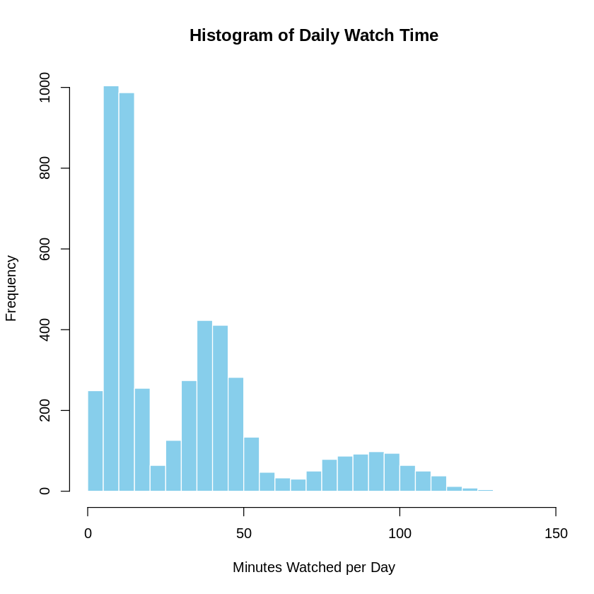
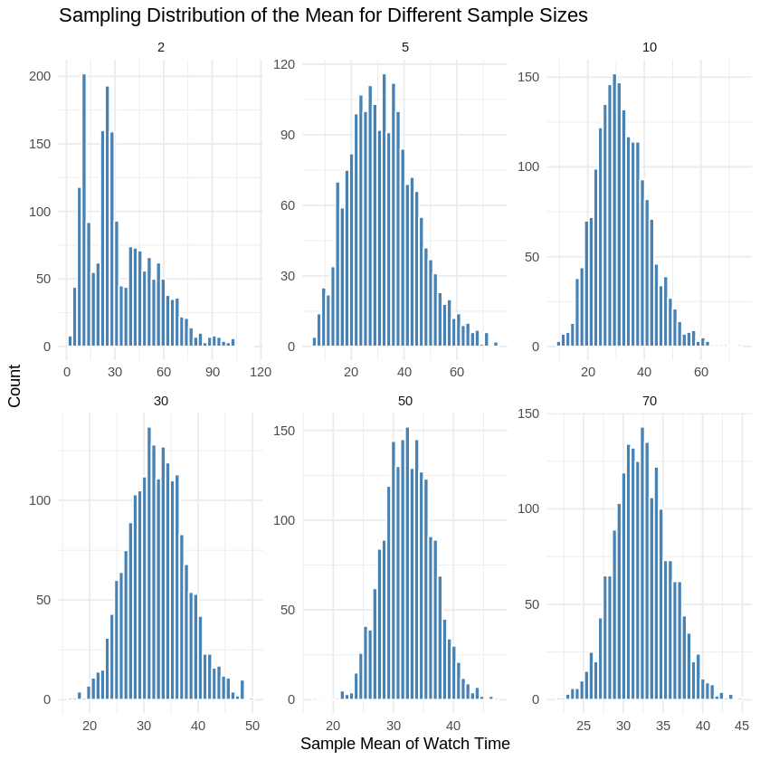
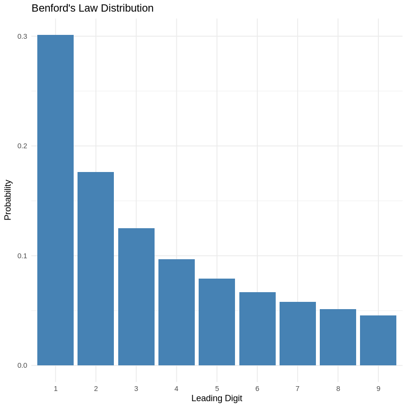
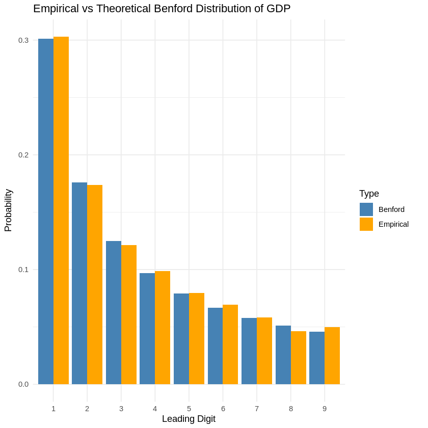

# Central Limit Theorem in Practice & Benford's Law

An empirical study of the Central Limit Theorem on real and simulated data,
and a verification of Benford's Law on real-world GDP data.

## Academic Context

- **Course:** Engineering Probability and Statistics (EPS)
- **Institution:** School of Electrical and Computer Engineering, University of Tehran
- **Instructors:** Dr. Bahrak, Dr. Vahhabi
- **Format:** fully executed R-kernel Jupyter notebook (`clt_and_benfords_law.ipynb`)

## Project Overview

The notebook covers two topics of the assignment:

1. **Central Limit Theorem in practice.** A skewed daily watch-time dataset
   is used to show how the distribution of sample means becomes
   bell-shaped as the sample size grows; the CLT is then checked on three
   simple known distributions by comparing simulated sampling distributions
   with the theoretical Normal curve.
2. **Benford's Law on real-world data.** The theoretical leading-digit
   distribution is implemented in R and verified against the empirical
   leading-digit distribution of total GDP computed from the `gapminder`
   dataset.

## Contents

### Central Limit Theorem in Practice

| Section | Topic |
|---|---|
| 1 | Skewed daily watch-time dataset: exploration, sample means for different sample sizes, probability that the sample mean lies in a given interval |
| 2 | CLT for `Uniform(0, 1)`, `Exponential(rate = 1)`, and `Bernoulli(p = 0.3)`: raw histograms vs. simulated sampling distributions (`n = 5, 10, 30`) with the theoretical Normal curve `N(μ, σ²/n)` overlaid |

### Benford's Law in Real-World Data

| Section | Topic |
|---|---|
| 1 | The CLT–Benford connection and the theoretical first-digit law `P(D = d) = log10(1 + 1/d)` |
| 2 | Implementation of Benford's Law in R and visualization of the theoretical distribution |
| 3 | Loading the `gapminder` dataset and constructing total `GDP = population × GDP per capita` |
| 4 | Extracting leading digits of GDP and comparing the empirical distribution with the theoretical Benford distribution |

## 📈 Key Visualizations

Selected outputs from the committed notebook — the full set of plots, logs
and metrics is embedded in the notebook itself.


*Original, strongly skewed daily watch-time distribution used to demonstrate the CLT.*


*Sampling distributions of the mean for increasing sample sizes.*


*Theoretical Benford first-digit probabilities, `P(D = d) = log10(1 + 1/d)`.*


*Empirical leading-digit frequencies of real-world GDP vs. the theoretical Benford curve.*

## Mathematical and Statistical Methods

- Sampling distribution of the mean and its convergence to
  `N(μ, σ²/n)` under the CLT, demonstrated for a skewed real dataset and for
  Uniform, Exponential, and Bernoulli parents.
- Benford's first-digit law `P(D = d) = log10(1 + 1/d)`, `d = 1, …, 9`,
  implemented as an R function.
- Construction of a scale-invariant economic variable (total GDP from
  population and GDP per capita) whose leading digits are then compared with
  the Benford prediction (empirical frequencies vs. theoretical probabilities,
  side-by-side bar plot).

## Technologies and Tools

- **Language:** R (R kernel in Jupyter/Colab)
- **Packages:** `ggplot2`, `tidyr`, `gapminder` (dataset package)
- **Notebook:** Jupyter Notebook / Google Colab

## Repository Structure

```text
eps-clt-and-benfords-law/
├── README.md
├── clt_and_benfords_law.ipynb          # fully executed notebook with all outputs
└── requirements.md    # environment and dependency instructions
```

## How to Run

### Google Colab

1. Upload `clt_and_benfords_law.ipynb` to Colab and switch the runtime to **R**.
2. Run all cells. The `gapminder` package is installed inside the notebook.
3. No external data files are required; all datasets are R packages or
   generated by simulation.

### Local Jupyter

```bash
R -e "install.packages(c('IRkernel','ggplot2','tidyr','gapminder')); IRkernel::inst()"
jupyter notebook clt_and_benfords_law.ipynb
```

See `requirements.md` for details.

## Dependencies

Documented in [`requirements.md`](requirements.md). In short: R with the
`IRkernel`, plus `ggplot2`, `tidyr`, and `gapminder`.

## Results and Key Findings

All findings below are taken from the executed notebook.

- **CLT on skewed data (Section 1):** sample means of the skewed watch-time
  dataset become increasingly bell-shaped and concentrated as the sample size
  grows, illustrating the CLT empirically.
- **CLT for known parents (Section 2):** for `Uniform(0, 1)`,
  `Exponential(1)`, and `Bernoulli(0.3)`, the simulated histograms of sample
  means for `n = 5, 10, 30` align with the theoretical Normal curve
  `N(μ, σ²/n)`; convergence is visible even for the strongly skewed
  exponential parent.
- **Benford verification (Sections 3–4):** with the 1,704 country-year rows of
  the `gapminder` dataset and `GDP = population × GDP per capita`, the
  empirical leading-digit frequencies follow the theoretical Benford curve
  (`log10(1 + 1/d)`); digit 1 is the most frequent (~30.3%) and frequencies
  decrease almost monotonically toward digit 9 (digits 8 and 9 are close,
  with 9 marginally higher than 8).

## Attribution

Assignment statements, section narratives, and point breakdowns are part of
the course material for the EPS assignment; the implementations and analysis
are the student's work for this project.

## Scope Note

The original assignment also included a parameter-estimation (MLE) section
that is not part of this repository; the topic line in the notebook header
therefore mentions a broader scope than the notebook content.
